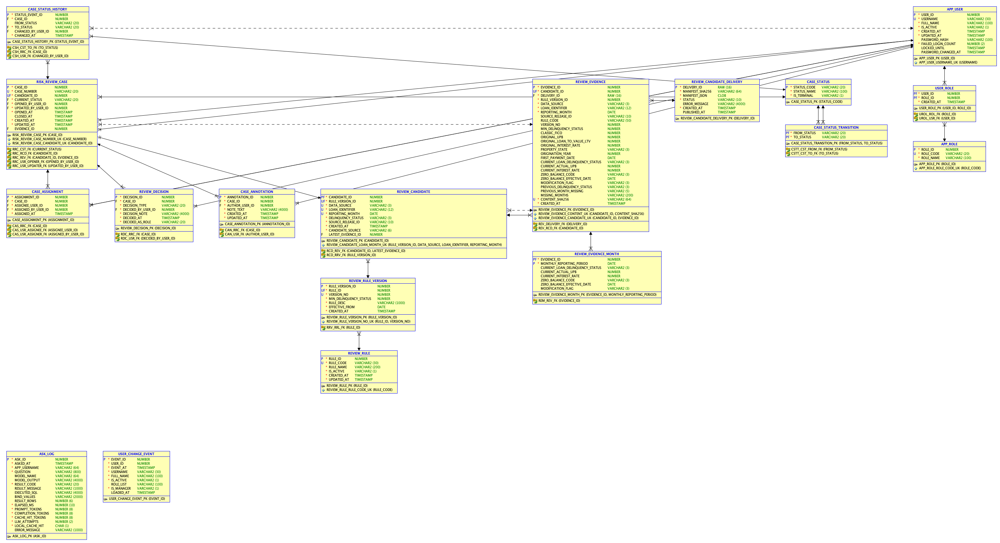
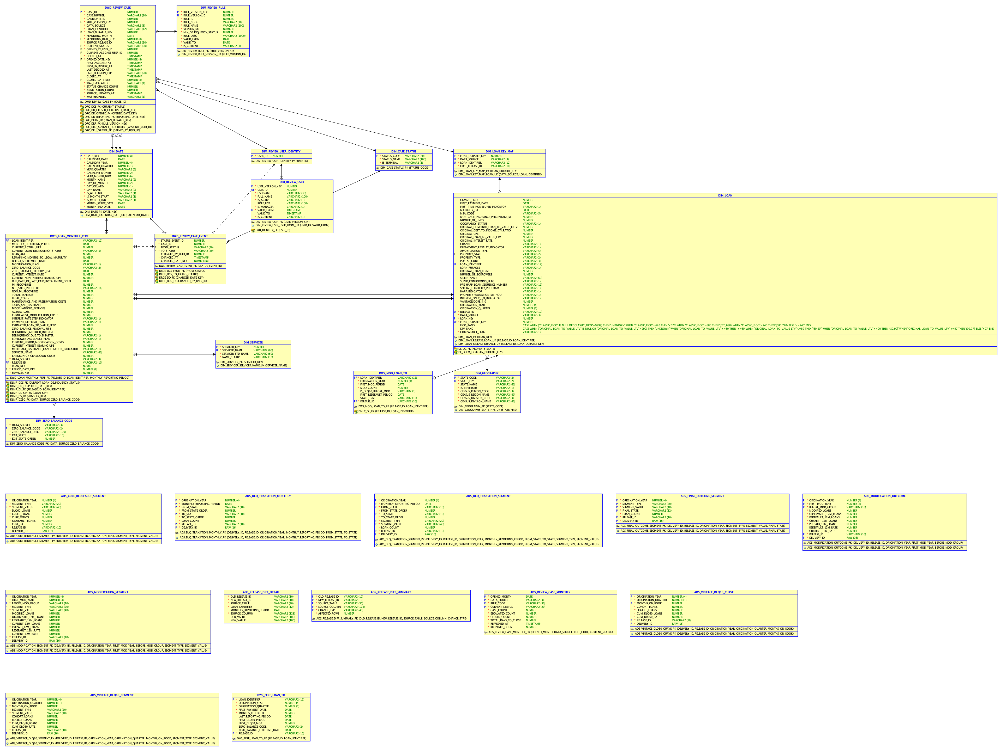
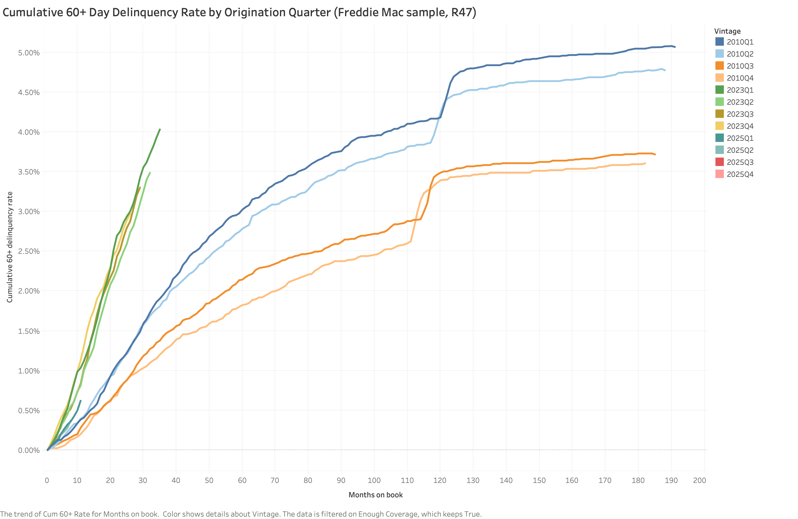

# Mortgage Loan Performance Data Platform

This project builds an end-to-end mortgage data platform from Freddie Mac loan-level data: archive verification, release-aware ETL, a layered warehouse, data-quality controls, three risk analyses, and a loan-review application. The target architecture uses HDFS/Hive and Spark for large-scale processing and Oracle for delivered analysis results and review operations. The Oracle sample warehouse published here is the development and regression reference. This update adds its full analytical star schema, external-table ETL, quality gate and quarantine, release comparison, targeted recomputation, and independent reconciliation. The existing read-only candidate application remains at its previously published scope.

## What the platform does

Component status below describes this public repository. The milestone table separately records wider-project progress.

| Component | What it does | Status |
|---|---|---|
| Raw archive | Records SHA-256 checksums in a manifest and verifies downloaded archives when the user runs the verification command; loading does not run this check automatically. | Done |
| ODS layer | Loads origination and monthly files as text into four layout-specific Oracle tables, records release and source file, and replaces a file's partition through a checked staging table. | Done |
| Release diff and targeted backfill | Compares normalized releases, identifies changed analytical inputs, copies unaffected summaries, and recomputes affected loans. | Done |
| Data warehouse — analytical star schema | Date, geography, servicer, loan and code dimensions; release-partitioned monthly facts; two loan summaries; eight analytical ADS tables. | Done |
| Data quality | Records rule results and offending rows; HARD failures stop processing, complete quarantine permits eligible row-level exclusions, and WARN results remain recorded. The load gate rejects checks older than the latest successful source load. | Done |
| Calculation lineage and review history | Completed design for calculation/input lineage and Type 2 review-rule/user history; these modules are outside this published sample path. | Design done |
| Large-scale processing | The Spark/Hive processing and delivery design is complete; large-scale implementation and tests exist in the wider project but are not included in this publication. | Design done |
| Loan-review application — candidate path | Three core OLTP tables, a versioned 60+ entry rule, a procedure that selects candidates from the warehouse, and a read-only Spring Boot candidate page. | Done |
| Loan-review application — full workflow | The wider project implements the Analyst/Manager workflow and timestamp-based CDC. This publication retains its completed 13-table design; full-workflow source is deferred from this update. | Design done |
| Data models | Oracle SQL Developer Data Modeler enterprise, logical, and relational models of the OLTP schema and the warehouse, with model-generated DDL (`docs/model/`). The models cover the full project schemas, including tables this version does not deploy. | Done |
| Dashboards — first chart | One Tableau chart of the cumulative 60+ curve by origination quarter (`docs/img/dlq60_curve.png`). | Done |
| Dashboards — full set | Tableau dashboards for all three analyses. | Planned |

## What this version can run

You can verify downloaded archives, deploy and load either supported Freddie file layout into Oracle, run source quality checks, load the analytical star schema, calculate all three analyses, compare releases, and recompute affected summaries. For the newer layout, separate Python implementations reconcile the vintage curve, transitions, modifications, and segmented analyses against raw files. External-table loading supports the newer layout; the Python loader supports both.

The candidate application still contains three core OLTP tables, candidate generation, and a read-only Spring Boot page listing up to 200 candidates with a bound loan-ID filter. It cannot open or decide cases. Its previously tested scope and the completed 13-table design remain in `docs/oltp_design.md`. The Tableau image `docs/img/dlq60_curve.png` is from the development warehouse; a workbook and the other dashboards are not included.

Review workflow/CDC, calculation lineage, Spark jobs, delivery publishing, and scheduling are not distributed here. Project milestone status below includes work completed beyond this public subset. This version was deployed into a new, empty database schema: setup steps 2–9 and the database tests passed.

## Questions it answers

The platform is designed to answer three questions:

1. How do loans move between delinquency states, including cures and repeat delinquency?
2. What outcomes follow a payment modification?
3. How does performance differ by origination year (vintage)?

This version calculates month-to-month delinquency transitions, cumulative 60+ curves by origination quarter and MOB, and 12-month outcomes after first modification. Each analysis also has separate groups for nine loan attributes; additional outputs cover final outcomes, cures, and relapse after cure. Aggregate counts before dividing: never average subgroup rates. See `docs/metric_definitions.md`.

## Status

The repository is updated at each milestone. Project status as of October 29, 2026: Milestones 1–4 are Done; Milestones 5–6 are In progress. Dates are targets and may change. Milestone status describes the wider project, while the runnable public subset is listed above.

| # | Milestone | Main deliverables | Target date | Status |
|---|---|---|---|---|
| 1 | Project Proposal | Proposal submitted | 09/19/2026 | Done |
| 2 | Environment, Source Data, and OLTP Design | Oracle in Docker; source data with checksum manifest; data profiling; ODS loaded; OLTP conceptual, logical, and relational design (3NF) | 10/03/2026 | Done |
| 3 | Thin End-to-End Path | One vintage through every layer: ODS → first fact table with DIM_DATE → one delinquency metric → one Tableau chart; OLTP models in Data Modeler, DDL, core tables; review candidates from the warehouse shown on one web page (Data Modeler models and DDL moved to Milestone 4) | 10/17/2026 | Done |
| 4 | Thicken the Databases and ETL | OLTP: all tables, indexes, triggers, functions, procedures, sample data, constraint and trigger tests, rule-mapping additions, Data Modeler models and DDL. Warehouse: full star schema with DIM_DATE, Enterprise / Logical / Relational models and DDL; ETL with external tables and PL/SQL; data quality rules and reconciliation; all three analyses | 10/31/2026 | Done |
| 5 | Thicken the Application and Change Processing | Analyst and Manager pages with menus; role-based grants and password management; validation, confirmations, SQL-injection and XSS protection; timestamp-based CDC from OLTP to the warehouse; release-diff and targeted backfill test case; lineage | 11/14/2026 | In progress |
| 6 | Reports, Scale-up, and Testing | Core: Tableau dashboards for roll-rate, vintage, and payment-modification analysis; Phase 2 Spark scale-up on multiple vintages with benchmark; end-to-end tests. Stretch (only if earlier milestones finish early): full-history Spark run on a multi-node cluster; additional-source comparison | 11/28/2026 | In progress |
| 7 | Final Deliverables | Final project report; presentation; demo rehearsal and recording | 12/06/2026 | Planned |

## Data models

Relational models from Oracle SQL Developer Data Modeler. They cover the full project schemas, including tables this version does not deploy. Enterprise and logical models and the generated DDL are in `docs/model/`.

Review application (OLTP):



Warehouse:



Tableau chart of the cumulative 60+ curve by origination quarter:



## Design notes

- The ODS stores source fields as text and adds `release_id` and `source_file`. Oracle stores empty strings as `NULL`, so this is not byte-for-byte preservation. Primary keys include `release_id`; versions of the same loan from different releases can coexist for later comparison.
- Tables follow file layout, not release number: R45/R46 use the earlier layout tables and R47 uses the newer layout tables. A new release with the same layout reuses its layout's tables.
- Reloading a file fills a staging table first, checks its row count and content fingerprint, and then exchanges the matching partition. The published partition is replaced as one operation rather than left half loaded.

## Source data

The [Freddie Mac Single-Family Loan-Level Dataset page](https://www.freddiemac.com/research/datasets/sf-loanlevel-dataset) provides a sample archive for each origination year. A full vintage year has a random sample of 50,000 loans; a partial year has fewer. Each archive has one origination file and one monthly performance file, both pipe-delimited. A vintage is the year a loan originated. Older vintages usually have more months of observed performance. You need one sample year for the ODS walkthrough; the database tests use their own small fixtures and require no downloaded data.

Download one sample archive (`sample_YYYY.zip`) and note its **actual filename**, origination year, and release. The July 2026 and later layout uses `sample_orig_YYYY.txt` and `sample_perf_YYYY.txt`; the earlier layout uses `sample_orig_YYYY.txt` and `sample_svcg_YYYY.txt`. Check the names inside your ZIP before choosing the ODS tables. If you use the newer layout and want to run the optional profiler, also download its matching File Headers; the older layout has no official header files for that script. The File Layout and User Guide on the data page explain the columns and codes. The full dataset is not needed here. Source data is not distributed in this repository.

The provided manifest records six archives used in this project, including earlier releases. It is **not** a checklist of required downloads. For a different archive or year, make your own manifest as shown below. A checksum from `docs/raw_manifest.csv` applies only to the exact file listed there; renaming another download does not make it the same file. A release ID such as `R47` is a label you supply to the loader and use consistently for that download.

## Repository layout

```text
scripts/       Oracle setup, ODS deployment, warehouse loads, external-table loading
python/        Database access, archive checks, loaders, independent raw-file reconciliation
source/ods/    Four source tables, stages, exchange procedure, load-event ledger, external tables
source/dim/    Date, loan, durable keys, geography, servicer, status/code dimensions, segment view
source/dwd/    Partitioned monthly fact, exchange stage, release loading, targeted recomputation
source/dws/    Per-loan performance and modification summaries
source/ads/    Three analyses, five segmented outputs, release-difference tables and procedures
source/rpt/    Read-only views for the three core analyses
source/oltp/   Previously published three-table candidate path
source/ops/    Previously published candidate-path grants
app/           Previously published read-only candidate page
checks/        Source/detail quality, issue/quarantine records, freshness gate, object checks
test/          Database-backed source-loader tests
docs/          Metric definitions, source-field map, review design, example manifest, images
docs/model/    Data Modeler enterprise, logical, and relational diagrams and model-generated DDL
```

## Setup and load one sample

Run these commands from the repository root in a bash shell. This walkthrough assumes Docker, Python 3.11, and macOS, Linux, or Windows with WSL 2. It was tested on macOS; the other platforms have not been verified. You need enough free disk space for the Oracle database image and files you download.

1. Start a new Oracle Database Free container, then wait for its health check. If you already created `oracle-db`, skip `docker run` and use the waiting script. The container uses a persistent Docker volume named `oracle-data`.

   ```bash
   docker run -d --name oracle-db -p 1521:1521 -e ENABLE_ARCHIVELOG=false -e ENABLE_FORCE_LOGGING=false -v oracle-data:/opt/oracle/oradata container-registry.oracle.com/database/free:latest
   scripts/0_start_db.sh
   ```

2. Create the `loan_dw` schema once. The creation script asks you to set a database password. After creating the Python environment in step 3, run `.venv/bin/python python/password_store.py set loan_dw` to save that same password to `~/.config/loan-dw/passwords.json`. Later commands read the password only from this private file and stop with a clear error if its account entry is missing. The file is outside the repository; its directory must be accessible only to you (`700`) and the file must be `600`. It is readable as plain text after login, so use full-disk encryption on your computer if you need protection while it is powered off. The scripts do not access the macOS Keychain.

   ```bash
   scripts/1_create_db_user.sh loan_dw
   ```

3. Create the Python environment and the four ODS tables, staging tables, fingerprint function, and exchange procedure. Deploy once to a new schema.

   ```bash
   python3.11 -m venv .venv
   .venv/bin/python -m pip install -r requirements.txt
   .venv/bin/python python/password_store.py set loan_dw
   scripts/2_create_ods.sh
   ```

4. Put your ZIP in `../data/raw/<release>/` (outside this repository). In the example below, replace `YEAR`, `RELEASE`, and `ARCHIVE` with your year, your release label, and the archive's actual filename. Run the assignments and commands in the same shell. The example values describe one archive; they are not required filenames or a required vintage.

   ```bash
   YEAR=2023
   RELEASE=R47
   ARCHIVE=sample_2023.zip
   RAW_DIR="../data/raw/$RELEASE"
   mkdir -p "$RAW_DIR"
   # Copy the downloaded ZIP to "$RAW_DIR/$ARCHIVE" using your file manager.
   .venv/bin/python python/raw_manifest.py build "$RAW_DIR" ../data/my_manifest.csv
   .venv/bin/python python/raw_manifest.py verify "$RAW_DIR" ../data/my_manifest.csv
   ```

   `build` records every non-hidden file in `$RAW_DIR`; `verify` must finish with “All N files in the manifest match” before loading. Keep the manifest outside that directory so it cannot list itself. To verify the exact project archives listed in `docs/raw_manifest.csv`, instead use `../data/raw` as the raw directory and that CSV as the manifest; missing listed archives make verification fail.

5. Inspect and extract the archive with Python's standard library. Choose the table names from the two filenames shown by the listing, not from the origination year. The example commands below assume the July 2026 or later layout.

   ```bash
   EXTRACT_DIR="../data/extracted/$RELEASE/sample_$YEAR"
   .venv/bin/python -m zipfile -l "$RAW_DIR/$ARCHIVE"
   mkdir -p "$EXTRACT_DIR"
   .venv/bin/python -m zipfile -e "$RAW_DIR/$ARCHIVE" "$EXTRACT_DIR"
   ```

6. Optionally profile a newer-layout sample before loading. Put its two matching official header text files in a directory of your choice and give their actual paths. The profiler prints counts and unmatched-loan counts; inspect those counts yourself. It does not fail merely because the origination and performance loan sets differ. Skip this step for an older-layout archive or if you did not download the File Headers.

   ```bash
   .venv/bin/python python/profile_sample.py "$EXTRACT_DIR/sample_orig_$YEAR.txt" /path/to/origination_data_file_header.txt "$EXTRACT_DIR/sample_perf_$YEAR.txt" /path/to/performance_data_file_header.txt
   ```

7. Load both files, then gather Oracle optimizer statistics. For the earlier layout, change `ods_orig` to `ods_orig_pre202607`, change `ods_perf` to `ods_perf_pre202607`, and load `sample_svcg_YYYY.txt` as the performance file. The `RELEASE` label must match the archive you extracted. Rerunning a successful load for the same release and filename replaces that file's partition.

   ```bash
   .venv/bin/python python/load_ods.py "$RELEASE" ods_orig "$EXTRACT_DIR/sample_orig_$YEAR.txt"
   .venv/bin/python python/load_ods.py "$RELEASE" ods_perf "$EXTRACT_DIR/sample_perf_$YEAR.txt"
   scripts/run_sql.sh source/ods/gather_ods_stats.sql
   ```

The loader checks the number of rows in its staging table and compares fingerprints before and after partition exchange. These are database-side checks; the raw ZIP's SHA-256 check is the separate manifest step. Oracle stores empty strings as `NULL`, so “raw text” does not mean byte-for-byte preservation of the source file.

8. Deploy the complete sample warehouse into a **fresh** `loan_dw` schema after ODS setup. Do not apply these CREATE TABLE statements over an existing installation. The order below creates referenced objects before compiling the loaders. Date, geography, and code seed loaders run as scripts; the loan and servicer loaders create procedures.

   ```bash
   scripts/run_sql.sh source/dim/dim_date.sql
   scripts/run_sql.sh source/dim/dim_geography.sql
   scripts/run_sql.sh source/dim/dim_servicer.sql
   scripts/run_sql.sh source/dim/dim_loan_key_map.sql
   scripts/run_sql.sh source/dim/dim_delinquency_status.sql
   scripts/run_sql.sh source/dim/dim_zero_balance_code.sql
   scripts/run_sql.sh source/dim/dim_loan.sql
   scripts/run_sql.sh source/dim/v_loan_segment.sql
   scripts/run_sql.sh source/dwd/dwd_loan_monthly_perf.sql
   scripts/run_sql.sh source/dwd/dwd_loan_monthly_perf_stage.sql
   scripts/run_sql.sh source/dwd/dw_recompute_loan.sql
   scripts/run_sql.sh source/dws/dws_perf_loan_td.sql
   scripts/run_sql.sh source/dws/dws_mod_loan_td.sql
   scripts/run_sql.sh source/ads/ads_vintage_dlq60_curve.sql
   scripts/run_sql.sh source/ads/ads_dlq_transition_monthly.sql
   scripts/run_sql.sh source/ads/ads_modification_outcome.sql
   scripts/run_sql.sh source/ads/ads_dlq_transition_segment.sql
   scripts/run_sql.sh source/ads/ads_final_outcome_segment.sql
   scripts/run_sql.sh source/ads/ads_cure_redefault_segment.sql
   scripts/run_sql.sh source/ads/ads_vintage_dlq60_segment.sql
   scripts/run_sql.sh source/ads/ads_modification_segment.sql
   scripts/run_sql.sh source/ads/ads_release_diff.sql
   scripts/run_sql.sh checks/dq_check_result.sql
   scripts/run_sql.sh checks/dq_issue.sql
   scripts/run_sql.sh checks/dq_ods_ready.sql
   scripts/run_sql.sh source/dim/load_dim_date.sql
   scripts/run_sql.sh source/dim/load_dim_geography.sql
   scripts/run_sql.sh source/dim/load_dim_delinquency_status.sql
   scripts/run_sql.sh source/dim/load_dim_zero_balance_code.sql
   scripts/run_sql.sh source/dim/load_dim_loan.sql
   scripts/run_sql.sh source/dim/load_dim_servicer.sql
   scripts/run_sql.sh source/dwd/load_dwd_loan_monthly_perf.sql
   scripts/run_sql.sh source/dws/load_dws_perf_loan_td.sql
   scripts/run_sql.sh source/dws/load_dws_mod_loan_td.sql
   scripts/run_sql.sh source/ads/load_ads_vintage_dlq60_curve.sql
   scripts/run_sql.sh source/ads/load_ads_dlq_transition_monthly.sql
   scripts/run_sql.sh source/ads/load_ads_modification_outcome.sql
   scripts/run_sql.sh source/ads/load_ads_dlq_transition_segment.sql
   scripts/run_sql.sh source/ads/load_ads_final_outcome_segment.sql
   scripts/run_sql.sh source/ads/load_ads_cure_redefault_segment.sql
   scripts/run_sql.sh source/ads/load_ads_vintage_dlq60_segment.sql
   scripts/run_sql.sh source/ads/load_ads_modification_segment.sql
   scripts/run_sql.sh source/ads/compare_dim_loan.sql
   scripts/run_sql.sh source/ads/compare_dwd_loan_monthly_perf.sql
   scripts/run_sql.sh source/ads/compare_releases.sql
   scripts/run_sql.sh source/dwd/find_recompute_loans.sql
   scripts/run_sql.sh source/dwd/recompute_downstream_targeted.sql
   scripts/run_sql.sh source/dwd/gather_dw_stats.sql
   scripts/run_sql.sh source/dwd/load_dw_release.sql
   scripts/run_sql.sh source/rpt/rpt_views.sql
   scripts/run_sql.sh checks/check_invalid_objects.sql
   ```

9. Check the loaded ODS release, then load the warehouse. HARD failures stop processing. Invalid loan references and invalid months may be excluded only after full row-level quarantine has been recorded. A later successful source reload invalidates the prior gate, so rerun `dq_ods.sql` after reloading.

   ```bash
   scripts/run_sql.sh checks/dq_ods.sql "release_id=$RELEASE"
   scripts/2_load_dw_release.sh "$RELEASE"
   ```

   The warehouse loader validates and exchanges the release fact partition before recomputing summaries. If summary processing fails after exchange, the detail is already new: investigate and rerun. This sample path does not provide the separate all-table delivery-pointer publication used by the wider platform.

   For a newer-layout sample, independently reconcile every result with the same raw files and matching official headers. The segmented check also needs the two official Census reference files named in `source/dim/load_dim_geography.sql`; put them in `CENSUS_DIR`.

   ```bash
   ORIG_HEADER=/path/to/origination_data_file_header.txt
   PERF_HEADER=/path/to/performance_data_file_header.txt
   CENSUS_DIR=/path/to/census_reference_files
   .venv/bin/python python/reconcile_dlq60_curve.py "$RELEASE" "$EXTRACT_DIR/sample_orig_$YEAR.txt" "$ORIG_HEADER" "$EXTRACT_DIR/sample_perf_$YEAR.txt" "$PERF_HEADER"
   .venv/bin/python python/reconcile_transition.py "$RELEASE" "$EXTRACT_DIR/sample_perf_$YEAR.txt" "$PERF_HEADER"
   .venv/bin/python python/reconcile_modification.py "$RELEASE" "$EXTRACT_DIR/sample_perf_$YEAR.txt" "$PERF_HEADER"
   .venv/bin/python python/reconcile_segment.py "$RELEASE" "$EXTRACT_DIR/sample_orig_$YEAR.txt" "$ORIG_HEADER" "$EXTRACT_DIR/sample_perf_$YEAR.txt" "$PERF_HEADER" "$CENSUS_DIR"
   ```

   Optional newer-layout external-table loading: run `scripts/3_create_ext_dir.sh` as an administrator to create the directory grant, then deploy `source/ods/ext_ods_tables.sql` and `source/ods/load_ods_from_ext.sql` through `scripts/run_sql.sh`. Run `checks/check_invalid_objects.sql` afterward. `scripts/4_load_ods_ext.sh "$RELEASE" ods_perf "$EXTRACT_DIR/sample_perf_$YEAR.txt" --compare` replaces that file and checks its fingerprint against the existing Python load. Rerun the quality check afterward.

   For release comparison, fully load both releases first, then run `scripts/run_sql.sh source/ads/run_compare_releases.sql old_release=OLD new_release=NEW`. To load a corrected release using a baseline, run `scripts/2_load_dw_release.sh NEW OLD`. Unchanged loan summaries are copied; affected loans are recomputed. Without a baseline the loader recomputes everything. `python/reconcile_loan_bands.py` is an additional check expecting all three releases R45, R46, and R47.

10. Create separate OLTP and page accounts, then deploy the core tables and package. Save passwords in the local password store before running the account scripts. The warehouse owner grants the OLTP owner direct SELECT on the monthly fact; the package needs this direct grant to compile. Deploy the tables and seed as `loan_oltp`, then compile and check the package.

    ```bash
    .venv/bin/python python/password_store.py set loan_oltp
    .venv/bin/python python/password_store.py set loan_app
    scripts/14_create_oltp_user.sh
    scripts/run_sql.sh source/ops/grant_dw_to_oltp.sql
    ORACLE_USER=loan_oltp scripts/run_sql.sh source/oltp/oltp_tables.sql
    ORACLE_USER=loan_oltp scripts/run_sql.sh source/oltp/oltp_seed.sql
    ORACLE_USER=loan_oltp scripts/run_sql.sh source/oltp/review_api.sql
    ORACLE_USER=loan_oltp scripts/run_sql.sh checks/check_invalid_objects.sql
    scripts/13_create_app_user.sh
    ```

11. Generate candidates as `loan_oltp` for one reporting month in the loaded release, then start the read-only page. `REPORTING_MONTH` is `YYYYMM`; choose a month represented in the fact table. The procedure adds a loan only when its delinquency level first crosses the rule threshold, and rerunning it does not duplicate existing candidates. The temporary SQL file only invokes the published package.

    ```bash
    REPORTING_MONTH=202501
    cat > /tmp/loan_review_generate.sql <<'SQL'
    variable created number
    begin
       review_api.generate_candidates(
          '&release_id', to_date('&reporting_month', 'YYYYMM'), 'DLQ60_ENTRY', :created
       );
       commit;
    end;
    /
    print created
    SQL
    ORACLE_USER=loan_oltp scripts/run_sql.sh /tmp/loan_review_generate.sql "release_id=$RELEASE" "reporting_month=$REPORTING_MONTH"
    rm /tmp/loan_review_generate.sql
    scripts/12_run_app.sh
    ```

Open `http://localhost:8081/candidates`. The page account has SELECT on only the three core OLTP tables, with no table-write or package-execute grant. The full review workflow remains outside this published version. The Data Modeler models and generated DDL for the full schemas are in `docs/model/`.

## Tests

After the ODS objects exist, run the database-backed tests with the same database user and password source used above:

```bash
.venv/bin/python -m unittest discover -s test -p "test_*.py"
```

The tests create and drop small temporary tables, exercise bad inputs and reloads, and do not need Freddie Mac data. They require a working Oracle connection and the deployed `ods_file_hash` function and `ods_exchange_file` procedure.

For the candidate page, compile the Java application after deploying the OLTP objects. With `scripts/12_run_app.sh` running in another terminal, the following request should return the candidate HTML page; add `?loan=LOAN_ID` to check the bound loan-ID filter. This version has no database-backed automated test for candidate generation or the page.

```bash
mvn -B -f app/pom.xml -DskipTests package
curl -f http://localhost:8081/candidates
```
