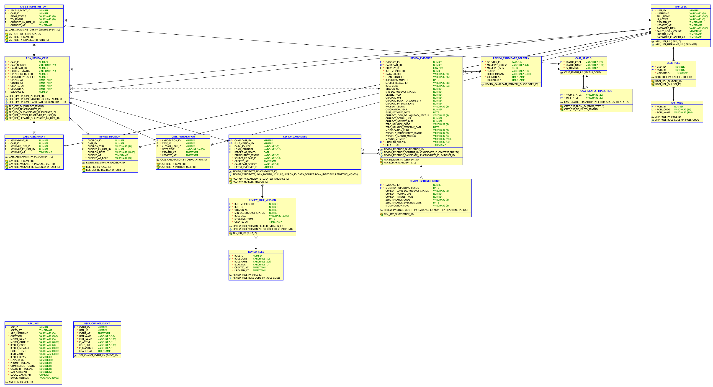
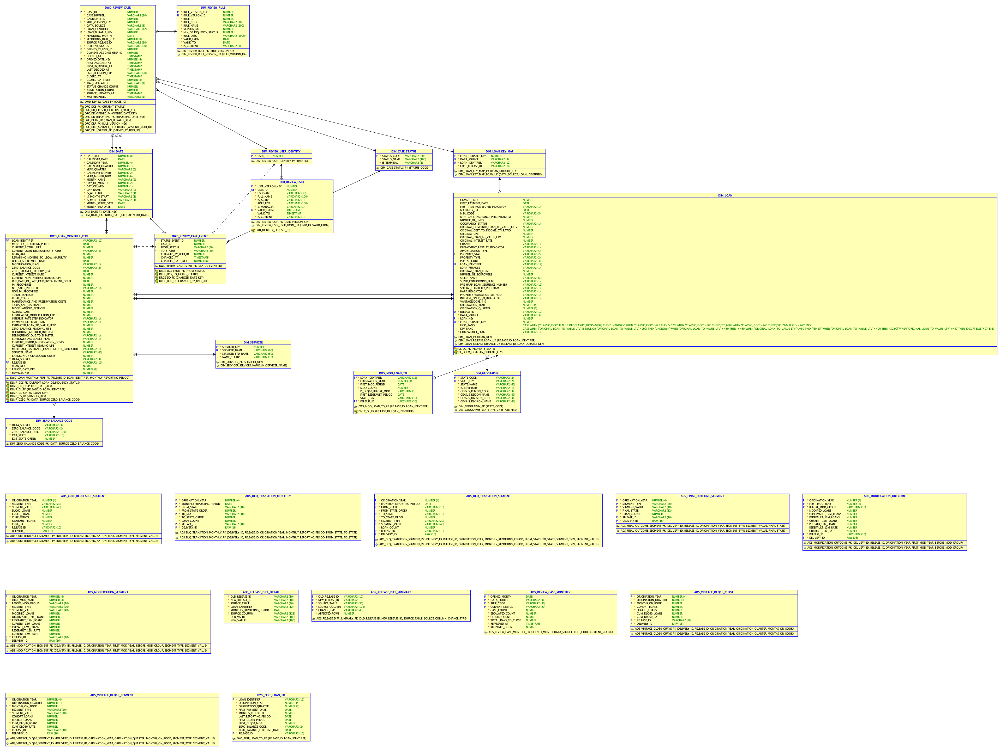
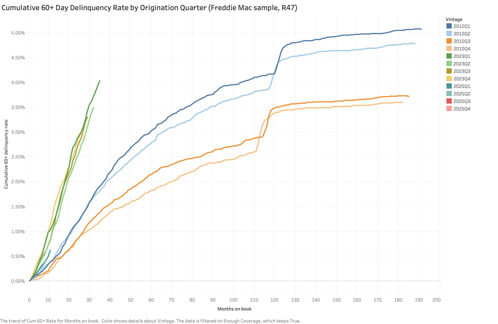

# Mortgage Loan Performance Data Platform

A bank-style loan risk data platform built on Freddie Mac loan-level mortgage data. It turns raw monthly loan files into a layered warehouse and three risk analyses, with data-quality controls and release-aware reprocessing, and feeds a loan-review application where analysts work on loans that turn delinquent.

The data are four origination years from the Freddie Mac sample files, 2006, 2007, 2010, and 2015, chosen to span the 2008 financial crisis: each year is a random sample of 50,000 loans with its complete monthly history. All processing runs in Oracle.

## Architecture

```text
Freddie Mac archives ──► checksum manifest
        │
        ▼
ODS (raw text, per release) ──► quality gate: stop / quarantine / warn
        │
        ▼
DIM + DWD (monthly facts) ──► DWS (per-loan summaries) ──► ADS (three analyses)
        │                                                      │
        ▼                                                      ▼
review candidates (PL/SQL) ──► review application         Tableau dashboards
        ▲                         (Spring Boot, OLTP)
        └── review report ◄── CDC ◄──┘
```

Every layer is built in Oracle: external tables read the source files into ODS, and PL/SQL procedures load the dimensions, the monthly fact table, the per-loan summaries, and the analysis tables. A PL/SQL procedure applies the review rule to the monthly facts and stages the loans that newly reached 60+ days delinquent, with their evidence; the importer checks the staged rows and publishes them to the review (OLTP) database in one transaction. Analysts and managers work the cases in the review application. Change data capture copies the case changes back into the warehouse, which builds the monthly review report. The Tableau dashboards read the analysis tables. Each load and calculation is recorded for lineage.

## Components

| Component | What it does | Status |
|---|---|---|
| Raw archive | SHA-256 manifest; downloaded archives are verified with a manual command before loading. | Done |
| ODS layer | Loads origination and monthly files as text, tagged with release and source file; a reload replaces one file's partition as a single step. | Done |
| Analytical star schema | Date, geography, servicer, loan, and code dimensions; release-partitioned monthly facts; per-loan summaries; eight analysis tables. | Done |
| Data quality | Rule results and offending rows are recorded; HARD failures stop the load, invalid loan references and months can be quarantined, warnings are kept. | Done |
| Release diff and targeted backfill | Compares two releases, finds loans whose history changed, copies unchanged loan summaries, and recomputes only the changed loans. | Done |
| Data models | Data Modeler enterprise, logical, and relational models with generated DDL (`docs/model/`). | Done |
| Review application | Spring Boot pages for analysts and managers: candidate list with evidence, open, assign, note, close, escalate, reopen, monthly report, password change. Roles are checked against the database on every action; a decision made from an outdated page is refused. | Done |
| Review candidates | A PL/SQL procedure applies the review rule to the monthly facts and stages each new 60+ loan with its origination fields and 13 months of history; the importer rechecks every staged row and its digest, then merges them into the review database in one transaction. Identical content is published once, and each case stays pinned to the evidence it was opened with. | Done |
| Change data capture | Timestamp-based extraction of review changes from OLTP into case fact tables with an overlap window for late commits, a user dimension kept as SCD2, and a monthly review report reconciled against OLTP. | Done |
| Lineage | Each load registers a source batch verified against the archive checksum, the extracted text, and ODS; each DWS/ADS publication records its row count, result digest, input batch, parent calculation, and code version. | Done |
| End-to-end test | One script deploys an empty database, loads the four sample years, builds every layer, publishes candidates, walks one case through the web application over HTTP, captures the changes, and checks the monthly review report. | Done |
| Distributed processing for the full history | Extension beyond this version: processing the full Freddie Mac history on a distributed engine, with scheduling. | Planned |
| Dashboards — first chart | Cumulative 60+ curve by origination quarter (below). | Done |
| Dashboards — full set | Tableau workbook for all three analyses (`dashboards/`), generated from the analysis tables of the four sample years; the charts are still being checked and exported as images. | In progress |

## Analyses

1. **Delinquency roll rates**: how loans move between delinquency states month to month, including cures and repeat delinquency.
2. **Vintage curves**: cumulative 60+ day delinquency by origination quarter and months on book.
3. **Payment modifications**: outcomes in the 12 months after a loan's first modification.

Each analysis is also split by nine loan attributes such as credit score and loan-to-value. Rates are computed from summed counts, never by averaging subgroup rates. A separate Python script recomputes every result from the raw files, and the cells match. Definitions are in `docs/metric_definitions.md`.

## Engineering highlights

- **Reloads are all-or-nothing.** A file is loaded into a staging table, its row count and content fingerprint are checked, and then it replaces the live partition in one step, so readers never see a half-loaded file.
- **Corrections recompute only what changed.** Freddie Mac reissues the full history in each release, so a new release is loaded in full and kept beside the previous one. The two are compared loan by loan; summaries of unchanged loans are copied, and only loans whose history changed are recomputed.
- **Quality gate before loading.** Every rule result and offending row is recorded. Problems that make a whole file suspect, such as an empty file, duplicate keys, or an unknown status code, stop the load. Defects confined to one row, such as a monthly record for an unknown loan or an invalid month, are quarantined and the rest is loaded. The warehouse load refuses a quality check older than the latest source load.
- **Least privilege.** The web application logs in as its own account, which reads the review tables and one report view, inserts review records, and updates only two case columns and its own password columns. It cannot delete rows, read ODS or the underlying analysis tables, or create objects; a SQL test proves this by logging in as that account.
- **Safe web input.** All SQL uses bound parameters, all page output is escaped, a Content Security Policy blocks inline scripts, every form carries a CSRF token, and critical decisions need an explicit confirmation checked on the server. Passwords are stored as BCrypt hashes, and five wrong attempts lock an account for 15 minutes.
- **No lost updates.** Two managers deciding from the same page state cannot both succeed: the service locks the case and compares the state the page showed with the current state before writing.
- **Change capture that does not miss late commits.** The watermark is the time a run started, and each run re-reads an overlap window; writes are merges, so re-read rows never duplicate. A test proves a late-committed change is missed with no overlap and caught with it.

## Data models

Review application (OLTP):



Warehouse:



Cumulative 60+ delinquency by origination quarter (Tableau):



## Status

Updated at each milestone. As of November 19, 2026, Milestones 1–5 are Done and Milestone 6 is In progress.

| # | Milestone | Main deliverables | Target date | Status |
|---|---|---|---|---|
| 1 | Project Proposal | Proposal submitted | 09/19/2026 | Done |
| 2 | Environment, Source Data, and OLTP Design | Oracle in Docker; source data with checksum manifest; data profiling; ODS loaded; OLTP conceptual, logical, and relational design (3NF) | 10/03/2026 | Done |
| 3 | Thin End-to-End Path | One vintage through every layer: ODS → first fact table with DIM_DATE → one delinquency metric → one Tableau chart; OLTP models in Data Modeler, DDL, core tables; review candidates from the warehouse shown on one web page (Data Modeler models and DDL moved to Milestone 4) | 10/17/2026 | Done |
| 4 | Thicken the Databases and ETL | OLTP: all tables, indexes, triggers, functions, procedures, sample data, constraint and trigger tests, rule-mapping additions, Data Modeler models and DDL. Warehouse: full star schema with DIM_DATE, Enterprise / Logical / Relational models and DDL; ETL with external tables and PL/SQL; data quality rules and reconciliation; all three analyses | 10/31/2026 | Done |
| 5 | Thicken the Application and Change Processing | Analyst and Manager pages with menus; role-based grants and password management; validation, confirmations, SQL-injection and XSS protection; timestamp-based CDC from OLTP to the warehouse; release-diff and targeted backfill test case; lineage | 11/14/2026 | Done |
| 6 | Reports and Testing | Tableau dashboards for roll-rate, vintage, and payment-modification analysis; end-to-end tests | 11/28/2026 | In progress |
| 7 | Final Deliverables | Final project report; presentation; demo rehearsal and recording | 12/06/2026 | Planned |

## Repository layout

```text
scripts/       Oracle setup, ODS deployment, warehouse loads, external-table loading, accounts, web application, end-to-end test
python/        Database access, archive checks, reconciliation, source-batch verification, candidate publication, dashboard export
source/ods/    Four source tables, stages, exchange procedure, load-event ledger, external tables
source/dim/    Date, loan, durable keys, geography, servicer, status/code, review rule (SCD2) and review user (SCD2) dimensions
source/dwd/    Partitioned monthly fact, release loading, targeted recomputation, review case facts and CDC procedure
source/dws/    Per-loan performance and modification summaries
source/ads/    Three analyses, five segmented outputs, release-difference tables, monthly review report
source/rpt/    Read-only report views
source/oltp/   Review tables, triggers, seed data, candidate delivery tables, candidate selection procedure
source/ops/    Account grants, environment marker, run log, source batches, calculation lineage and result history
source/migrate/ Grant added after the first OLTP release
app/           Review web application (Spring Boot, Thymeleaf, Spring Security) and its tests
checks/        Source/detail quality, issue/quarantine records, freshness gate, CDC reconciliation, object checks, space by layer
test/          Database tests for loaders, review workflow, CDC, report, dimensions, privileges, candidate selection and publication; end-to-end review walk-through
docs/          Setup steps, metric definitions, source-field map, review design, manifest, images
docs/model/    Data Modeler enterprise, logical, and relational diagrams and model-generated DDL
dashboards/    Tableau workbook of the three analyses and its generator
```

## Run it locally

You need Docker, Python 3.11, Java 17 with Maven, and the four free sample years 2006, 2007, 2010, and 2015 from the [Freddie Mac Single-Family Loan-Level Dataset](https://www.freddiemac.com/research/datasets/sf-loanlevel-dataset). ODS loading uses Oracle external tables for both supported file layouts. Step-by-step commands and tests are in `docs/setup.md`; `scripts/run_end_to_end.sh` runs the whole path on an empty database, and this version passed it.
